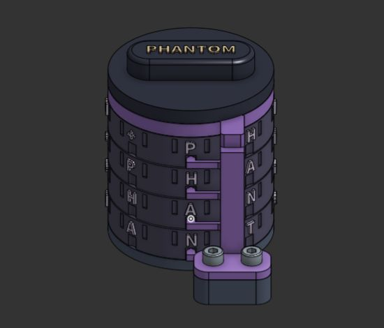
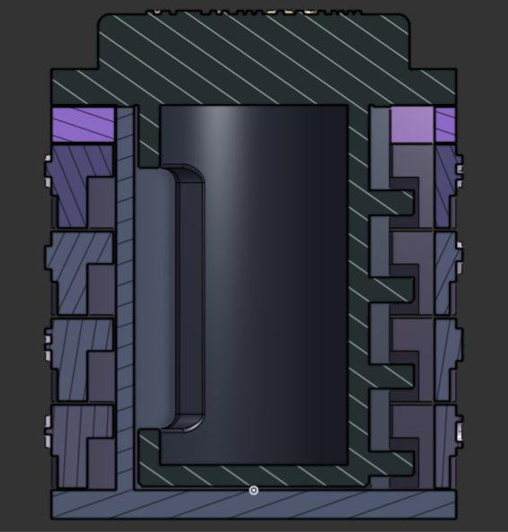

# cryptbox

I wanted to get better at CAD and thought it'd be fun to make a puzzle box. This one's got four letter dials and a little vault that pulls out when you get the code right.

*The current design in Onshape.*

## What I built

There are four little tabs on the side of the vault, one for each dial. Get the letters right and the tabs slide through the gaps in the dials. If even one letter is off, that tab catches and the vault stays in.

The purple fingers are the bits that should make the dials click. They flex when you turn a dial and drop back into the next notch. They're part of the keeper, which holds the dials on the sleeve. I used two M4 socket-head screws to hold the keeper down. The nuts go in little hex pockets so they stay put while you tighten the screws.

## Try the CAD

You can mess around with it in Onshape. Under **Named positions**, start with **Seated — PHAN**, then try **Tabs through gates** and **Vault withdrawn** to see how it comes out. **Locked — scrambled** shows it with the letters turned away from the code. Use the **Keyway section** view to see what's going on inside. [Onshape assembly](https://cad.onshape.com/documents/f82b712d2a2aeb70c48efd27/w/13946e493e4c2f1a118ff0c2/e/38d3b953fca92bb6119f3fd6)

The code is **PHAN**, top to bottom at the purple fingers. Line up the letters and pull the handle. To lock it again, slide the vault back in and scramble the dials.

## Parts and hardware

| Qty | Part |
| ---: | --- |
| 1 | Fixed sleeve and base |
| 4 | Code dials, one of each |
| 1 | Keeper with four spring fingers |
| 1 | Removable vault with handle |
| 2 | M4 × 12 socket-head cap screws, ISO 4762 |
| 2 | M4 hex nuts, ISO 4032 |

Pop the nuts in from the bottom and hold them there while you start the screws from the top. [Underside of the nut pockets](images/keeper-nuts.jpg)

## CAD files

- [Assembly STEP](cryptbox-assembly.step) has the whole box, screws and nuts included.
- [Individual STLs](stls/) has all seven custom parts, one file per part in millimeters. The keeper is `retaining-collar.stl`.

If you want to look through the sketches or see how the parts were made, here's the [Onshape Part Studio](https://cad.onshape.com/documents/f82b712d2a2aeb70c48efd27/w/13946e493e4c2f1a118ff0c2/e/ba81a496c2104d3ae1caecc8).

## Where it’s at

In CAD, the vault clears the dials and the new screws through its full 58 mm pull. With the dials scrambled, all four tabs catch at about 1.9 mm. The first print still needs to show how freely the rings turn, how the fingers feel, and how well the nut pockets stand up to tightening, if this project gets accepted then I wanna actually 3d print it with filament with the print grant and test it.
